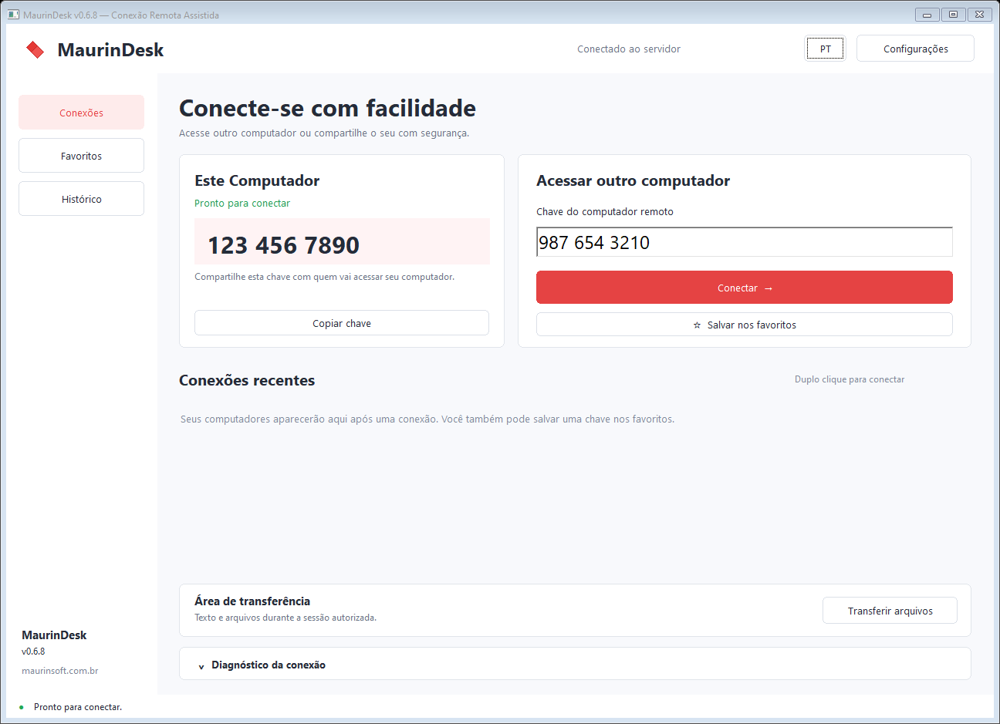
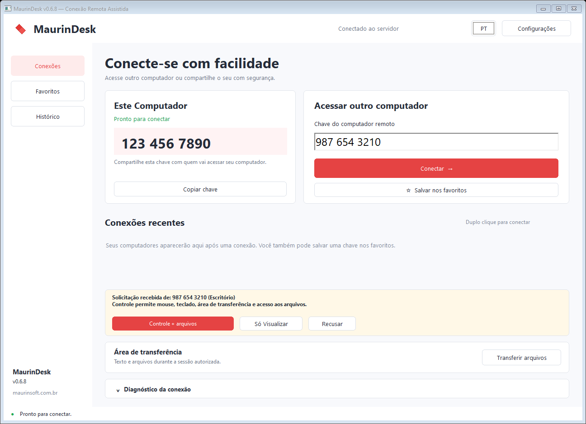
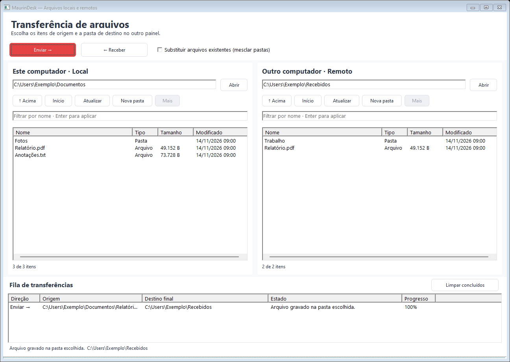

[Português](README.md) · **English** · [Español](README.es.md)

# MaurinDesk

### Simple remote assistance, with the person being helped always in control.

**MaurinDesk** takes you to the computer of whoever needs help, anywhere there is an internet connection. See the screen, take over the mouse and keyboard when authorized, and exchange files and folders, all in a single Windows program.

[**Download MaurinDesk**](bin/MaurinDesk.exe) · [User guide (Portuguese)](docs/14-recursos-desktop.md) · [Contact MaurinSoft](https://maurinsoft.com.br)

*Screenshots show the Portuguese interface with sample keys, names and files. The program is also available in English.*

## Why choose MaurinDesk

| | |
|---|---|
| **Ready in minutes** | Open the program and it shows the computer's key. No sign-up and no router setup. |
| **A 10-digit key** | To connect, type the key the other person gives you by phone or message. |
| **The receiver decides** | Every connection must be accepted on the spot, and the person chooses between granting control or only showing the screen. |
| **Files in the right place** | Send and receive files and whole folders, choosing the destination folder and following progress until they are saved. |
| **In your language** | Interface in Portuguese, English and Spanish. |
| **Always up to date** | The program looks for new versions and checks the file's integrity before installing. |

## Who it is for

- **Technical support and repair shops:** serve customers without travelling and solve it on the first call.
- **Offices and teams:** help a colleague, follow a task or fetch a document from another company computer.
- **Classes and training:** show your screen to explain a procedure, without handing over control.
- **Family and friends:** help someone far away install, set up or find what they need.

## How it works

1. **Open MaurinDesk on both computers.** Each one gets its own 10-digit key.
2. **Type the other computer's key** and click **Connect**.
3. **The other person accepts the request** and the session begins. Either side can end it at any time.

## What you can do with it

| Feature | What it delivers |
|---|---|
| **Remote screen** | See the other computer in a resizable window or in full screen. |
| **Mouse and keyboard** | Work on the remote computer as if you were sitting at it, when authorized. |
| **View only** | Share the screen for demonstrations, with no control and no file access. |
| **File transfer** | Two panels, one per computer, with a queue and confirmation that files were saved. |
| **Copy and paste** | Use Ctrl+C and Ctrl+V between the two computers during the session. |
| **Favorites and history** | Keep the computers you have helped under an easy-to-remember name. |
| **Always at hand** | Stays next to the Windows clock and can start with the computer. |

## Trust in every connection

- **Nothing happens without authorization.** Knowing the key does not grant access; every connection must be accepted by the person at the computer.
- **Clear permissions.** The person being helped chooses between control with files, view only, or declining.
- **Rules for files.** Only the side that started the connection browses the other computer's files, and only when that was authorized.
- **Out in the open.** The program stays visible during the session and either participant can disconnect.
- **Existing files preserved.** By default, nothing is replaced at the destination unless you ask for it.
- **Protected communication.** The computers talk to the service over a secure connection (HTTPS).

## What you need

- 64-bit Windows on both computers.
- Internet access.
- MaurinDesk open on both sides, preferably in the same version.

## Get started

[**Download MaurinDesk for Windows**](bin/MaurinDesk.exe) and open the file: that is enough for your first session. To keep the program installed, use the settings option that installs it on the computer.

Want to use MaurinDesk in your company, or have a specific need? [Contact MaurinSoft](https://maurinsoft.com.br).

## Documentation

- [User guide](docs/14-recursos-desktop.md) (in Portuguese): step-by-step instructions for each feature and answers to common questions.
- [Technical documentation](docs/README.md) (in Portuguese): architecture, build, server and maintenance.
- [Version history](CHANGELOG.md) (in Portuguese)
