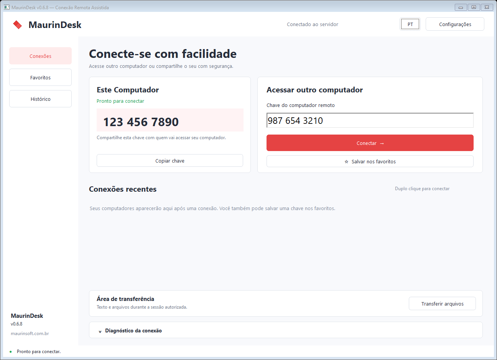
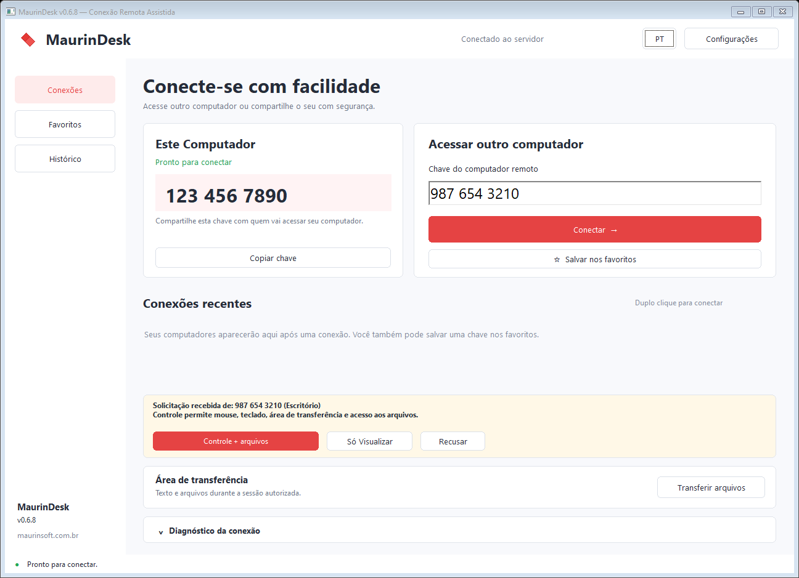
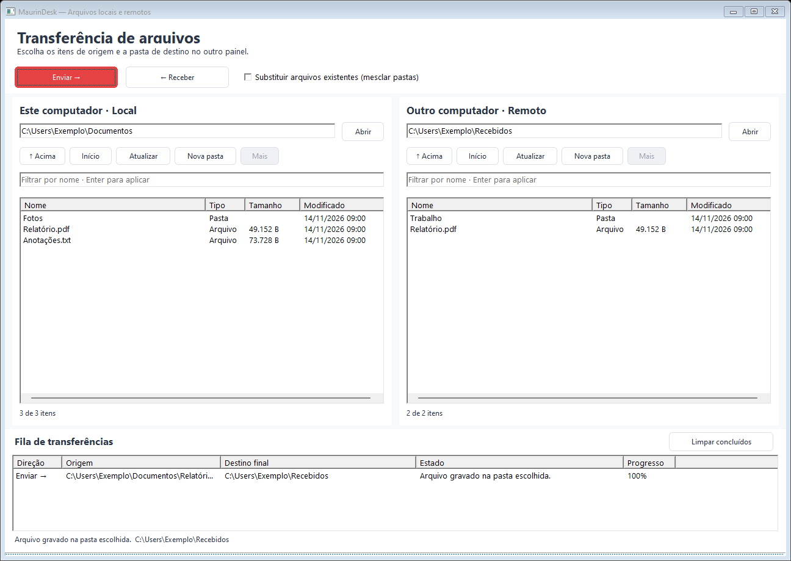

[Português](README.md) · [English](README.en.md) · **Español**

# MaurinDesk

### Asistencia remota sencilla, con la persona atendida siempre al mando.

**MaurinDesk** le lleva hasta el ordenador de quien necesita ayuda, en cualquier lugar con internet. Vea la pantalla, tome el ratón y el teclado cuando se le autorice e intercambie archivos y carpetas, todo en un único programa para Windows.

[**Descargar MaurinDesk**](bin/MaurinDesk.exe) · [Guía del usuario (en portugués)](docs/14-recursos-desktop.md) · [Contactar con MaurinSoft](https://maurinsoft.com.br)

*Las imágenes muestran la interfaz en portugués con claves, nombres y archivos de ejemplo. El programa también está disponible en español.*

## Por qué elegir MaurinDesk

| | |
|---|---|
| **Listo en minutos** | Abra el programa y verá la clave del ordenador. Sin registro y sin tocar el router. |
| **Una clave de 10 números** | Para conectar, basta con escribir la clave que la otra persona le indica por teléfono o mensaje. |
| **Quien recibe decide** | Cada conexión debe aceptarse en el momento, y la persona elige entre ceder el control o solo mostrar la pantalla. |
| **Archivos en su sitio** | Envíe y reciba archivos y carpetas completas eligiendo la carpeta de destino, con seguimiento hasta que quedan guardados. |
| **En su idioma** | Interfaz en portugués, inglés y español. |
| **Siempre al día** | El programa busca nuevas versiones y comprueba la integridad del archivo antes de instalar. |

## Para quién es

- **Soporte técnico y servicios de asistencia:** atienda a sus clientes sin desplazarse y resuelva en la primera llamada.
- **Oficinas y equipos:** ayude a un compañero, siga una tarea o recupere un documento de otro ordenador de la empresa.
- **Clases y formación:** muestre su pantalla para explicar un procedimiento, sin ceder el control.
- **Familia y amigos:** ayude a quien está lejos a instalar, configurar o encontrar lo que necesita.

## Cómo funciona

1. **Abra MaurinDesk en los dos ordenadores.** Cada uno recibe su clave de 10 números.
2. **Escriba la clave del otro ordenador** y haga clic en **Conectar**.
3. **La otra persona acepta la solicitud** y comienza la sesión. Cualquiera de los dos puede terminarla cuando quiera.

## Qué puede hacer con él

| Función | Qué ofrece |
|---|---|
| **Pantalla remota** | Vea el otro ordenador en una ventana ajustable o a pantalla completa. |
| **Ratón y teclado** | Trabaje en el ordenador remoto como si estuviera delante de él, cuando se le autorice. |
| **Solo ver** | Comparta la pantalla para demostraciones, sin control ni acceso a archivos. |
| **Transferencia de archivos** | Dos paneles, uno por ordenador, con cola y confirmación de guardado. |
| **Copiar y pegar** | Use Ctrl+C y Ctrl+V entre los dos ordenadores durante la sesión. |
| **Favoritos e historial** | Guarde los ordenadores atendidos con un nombre fácil de recordar. |
| **Siempre a mano** | Permanece junto al reloj de Windows y puede iniciarse con el ordenador. |

## Confianza en cada conexión

- **Nada ocurre sin autorización.** Conocer la clave no da acceso; cada conexión debe aceptarla quien está en el ordenador.
- **Permisos claros.** La persona atendida elige entre control con archivos, solo ver o rechazar.
- **Reglas para los archivos.** Solo quien inició la conexión explora los archivos del otro ordenador, y únicamente cuando se autorizó.
- **Todo a la vista.** El programa permanece visible durante la sesión y cualquiera de los participantes puede desconectar.
- **Archivos existentes a salvo.** De forma predeterminada, nada se sustituye en el destino si usted no lo pide.
- **Comunicación protegida.** Los ordenadores se comunican con el servicio mediante una conexión segura (HTTPS).

## Qué se necesita

- Windows de 64 bits en los dos ordenadores.
- Acceso a internet.
- MaurinDesk abierto en ambos lados, preferiblemente en la misma versión.

## Empiece ahora

[**Descargar MaurinDesk para Windows**](bin/MaurinDesk.exe) y abrir el archivo es suficiente para la primera sesión. Para dejar el programa instalado, use la opción de la configuración que lo instala en el ordenador.

¿Quiere usar MaurinDesk en su empresa o tiene una necesidad concreta? [Contacte con MaurinSoft](https://maurinsoft.com.br).

## Documentación

- [Guía del usuario](docs/14-recursos-desktop.md) (en portugués): instrucciones paso a paso de cada función y respuestas a las dudas más comunes.
- [Documentación técnica](docs/README.md) (en portugués): arquitectura, compilación, servidor y mantenimiento.
- [Historial de versiones](CHANGELOG.md) (en portugués)
