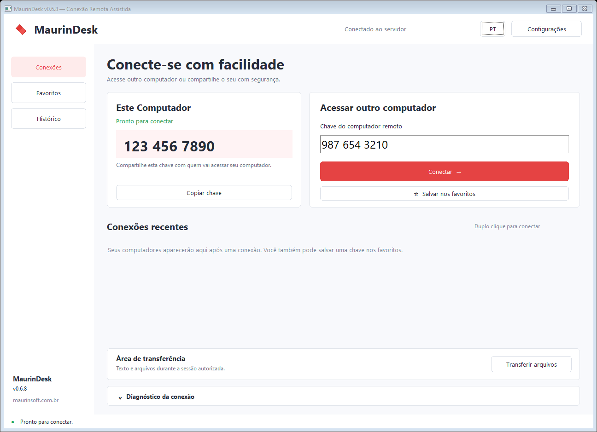
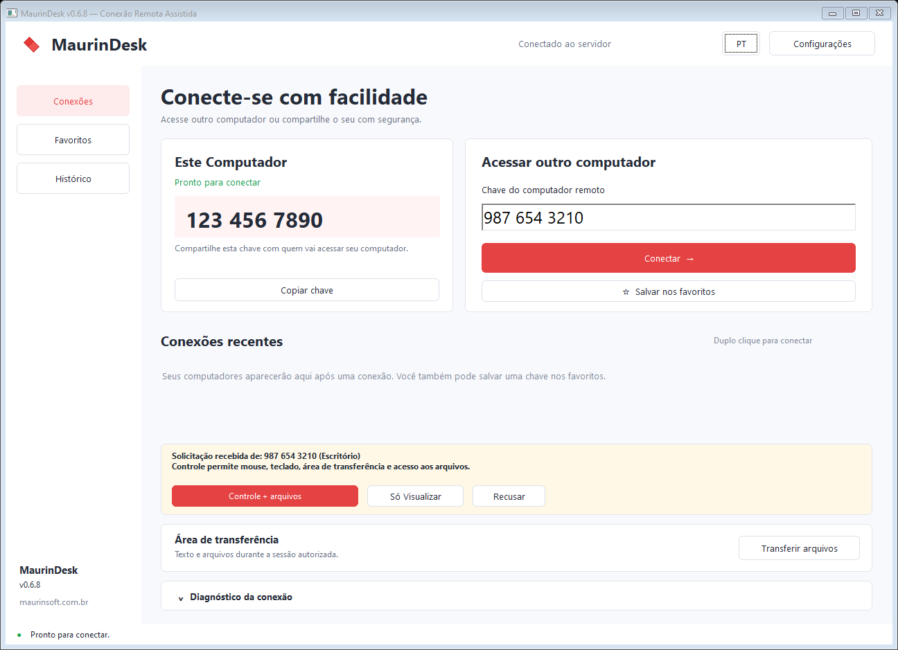
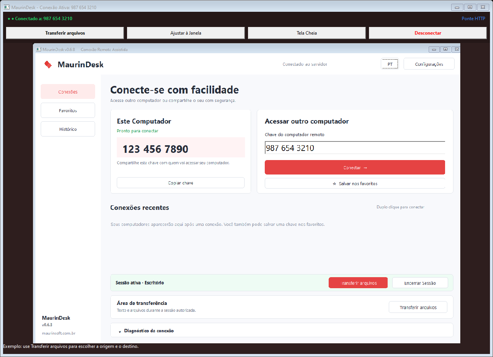
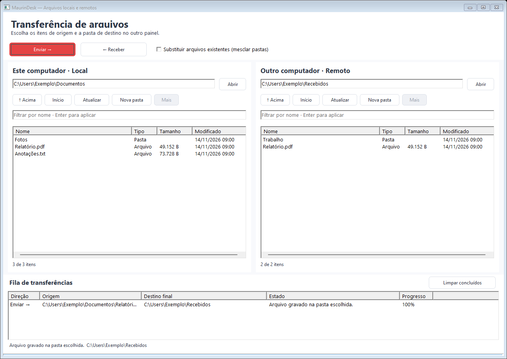
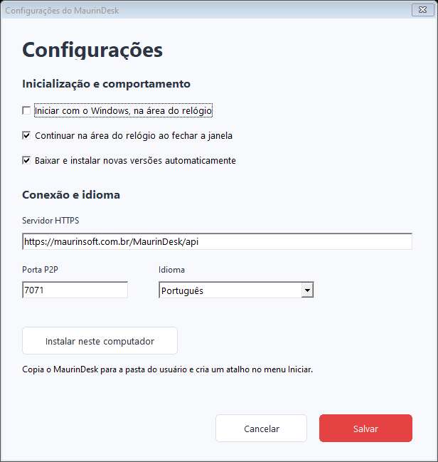

# MaurinDesk

### Acesse outro computador. Compartilhe sua tela. Troque arquivos.

O **MaurinDesk** permite ajudar alguém à distância, acompanhar uma tarefa em outro computador e enviar ou receber arquivos e pastas. A pessoa que recebe o pedido escolhe se autoriza o acesso e quais ações permite.

**Para Windows de 64 bits · Guia da versão 0.6.8**

[Abrir o aplicativo](bin/MaurinDesk.exe) · [Guia completo](docs/14-recursos-desktop.md) · [Tirar dúvidas](#dúvidas-frequentes)

*As capturas deste guia mostram a interface do programa com chaves, nomes, arquivos e situações de exemplo. Os números das imagens não devem ser usados para conectar.*

## O que você pode fazer

| Quero… | O MaurinDesk permite… |
|---|---|
| Ajudar alguém no computador | Ver a tela e, com autorização, usar o mouse e o teclado. |
| Mostrar algo para outra pessoa | Compartilhar a tela com a opção **Só visualizar**. |
| Enviar um documento ou uma pasta | Escolher o conteúdo e a pasta onde ele será salvo no outro computador. |
| Trazer arquivos do outro computador | Selecionar o conteúdo remoto e escolher onde recebê-lo no seu computador. |
| Copiar um texto entre os computadores | Usar **Ctrl+C** e **Ctrl+V** durante uma sessão autorizada. |
| Encontrar um computador novamente | Guardar sua chave nos favoritos e associar um nome. |
| Manter o programa à mão | Deixá-lo perto do relógio do Windows e escolher se inicia junto com o computador. |

## Comece em poucos passos

Tenha o MaurinDesk aberto nos **dois computadores**, com acesso à internet. Para usar os mesmos recursos, mantenha os dois programas atualizados.

1. Abra **MaurinDesk.exe** e aguarde aparecer sua chave de **10 números**.
2. Peça à outra pessoa a chave que aparece no computador dela.
3. Em **Acessar outro computador**, digite essa chave e clique em **Conectar**.
4. Aguarde a pessoa do outro lado aceitar o pedido.
5. Quando a tela remota abrir, comece o atendimento. Ao terminar, clique em **Desconectar**.

**Para receber ajuda:** informe sua chave à pessoa de confiança e aguarde o pedido aparecer. Compartilhar a chave não substitui a autorização da conexão.

## Você escolhe o acesso

Ao receber uma solicitação, confira quem está pedindo acesso e escolha:

| Opção | O que acontece |
|---|---|
| **Controle + arquivos** | Permite usar o mouse e o teclado, compartilhar a área de transferência e transferir arquivos. |
| **Só visualizar** | Permite acompanhar a tela, sem controlar o computador ou transferir arquivos. |
| **Recusar** | Não permite a conexão solicitada. |

*Autorize somente pessoas que você conhece. Qualquer participante pode encerrar a conexão.*

## Durante a conexão

A barra superior do visualizador reúne os comandos principais:

- **Transferir arquivos:** abre as pastas dos dois computadores para enviar e receber conteúdo.
- **Ajustar à Janela:** ajusta a imagem remota ao espaço disponível.
- **Tela Cheia:** amplia o visualizador; use o mesmo botão para sair desse modo.
- **Desconectar:** encerra o acesso remoto.

**Transferir arquivos** também aparece no painel da sessão ativa da janela principal.

## Envie e receba arquivos e pastas

Com a conexão autorizada em **Controle + arquivos**, clique em **Transferir arquivos**.

| Painel | O que ele mostra |
|---|---|
| **Este computador · Local**, à esquerda | As pastas e os arquivos do computador em que você está usando o programa. |
| **Outro computador · Remoto**, à direita | As pastas e os arquivos do outro participante da conexão. |

### Para enviar ao outro computador

1. Selecione os arquivos ou as pastas no painel **Local**.
2. No painel **Remoto**, abra a pasta em que deseja salvá-los.
3. Clique em **Enviar →**.
4. Acompanhe a fila até aparecer a confirmação de gravação.

### Para receber no seu computador

1. Selecione os arquivos ou as pastas no painel **Remoto**.
2. No painel **Local**, abra a pasta em que deseja recebê-los.
3. Clique em **← Receber**.
4. Aguarde a confirmação e confira o conteúdo na pasta escolhida.

**Confira a pasta de destino antes de começar.** Por padrão, o programa preserva arquivos que já existem. A opção **Substituir arquivos existentes (mesclar pastas)** permite trocar arquivos de mesmo nome pelo conteúdo recebido; marque-a apenas quando essa for sua intenção.

Para vários itens, use **Ctrl** enquanto seleciona. Para abrir uma pasta, dê dois cliques. [Veja mais exemplos no guia completo](docs/14-recursos-desktop.md#enviar-e-receber-arquivos).

## Copie e cole entre os computadores

Durante uma conexão com autorização de controle e arquivos, copie um texto com **Ctrl+C** e cole no outro computador com **Ctrl+V**.

Você também pode copiar arquivos e pastas dessa forma. Aguarde o recebimento antes de colar. Para escolher a pasta final e acompanhar o andamento com mais clareza, use **Transferir arquivos**.

## Deixe seus próximos acessos mais fáceis

- **Favoritos:** guarde a chave de um computador para encontrá-lo depois.
- **Histórico:** consulte computadores acessados anteriormente.
- **Nomes:** ao encerrar uma conexão, você pode associar um nome à chave, como “Escritório” ou “Computador da família”. Se deixar em branco, a chave continua sendo a identificação.

Salvar um computador não libera o acesso automaticamente. Cada nova conexão precisa ser aceita pela pessoa do outro lado.

## Configure do seu jeito

Abra **Configurações** no canto superior da janela.

| Opção | Para que serve |
|---|---|
| **Iniciar com o Windows, na área do relógio** | Abre o MaurinDesk quando você entra no Windows. |
| **Continuar na área do relógio ao fechar a janela** | Mantém o programa disponível mesmo depois de fechar a janela principal. |
| **Baixar e instalar novas versões automaticamente** | Procura novas versões e permite a atualização automática. |
| **Instalar neste computador** | Copia o aplicativo para uma pasta própria e cria um atalho no menu Iniciar. |
| **Idioma** | Permite escolher português, inglês ou espanhol. |

Depois de alterar suas preferências, clique em **Salvar**. As informações de conexão podem continuar como estão, salvo orientação de quem dá suporte ao programa.

**Perto do relógio:** se o ícone estiver escondido, procure na seta de ícones do Windows. Clique nele para abrir o programa. Para encerrar completamente, use **Sair do MaurinDesk** no menu do ícone.

## Dúvidas frequentes

**A chave ainda não apareceu. O que faço?**
Aguarde a conexão com o serviço. Confira a internet e tente abrir o programa novamente. Se continuar, abra **Diagnóstico da conexão** e encaminhe as informações para quem presta o suporte.

**Estou conectado, mas não consigo transferir arquivos.**
Use **Transferir arquivos** na barra do visualizador ou no painel da sessão ativa. Se o programa informar que não há autorização, faça uma nova conexão e peça para a pessoa escolher **Controle + arquivos**. Confira também se os dois programas estão atualizados. Se persistir, avise o suporte.

**Posso enviar uma pasta inteira?**
Sim. Selecione a pasta e escolha o destino no outro painel. O conteúdo, incluindo subpastas e pastas vazias, é copiado. Para um envio grande, divida o conteúdo em partes: o limite é de cerca de **255 MB por envio**.

**O arquivo vai direto para a pasta que escolhi?**
Sim, quando você usa **Transferir arquivos**. Confira a coluna **Destino final** e aguarde a confirmação de gravação na fila.

**Fechei a janela e o programa continua aberto.**
Isso acontece quando a opção de continuar na área do relógio está marcada. Use **Sair do MaurinDesk** para encerrar completamente.

**Fechar a janela de arquivos cancela o envio?**
Não. A fila continua enquanto a sessão estiver ativa. Encerrar a sessão interrompe as transferências.

## Saiba mais

O [guia completo de uso](docs/14-recursos-desktop.md) traz os passos detalhados, cuidados com arquivos de mesmo nome, instalação, atualização e orientações para resolver dificuldades.

[Ver as mudanças entre versões](CHANGELOG.md) · [Site MaurinSoft](https://maurinsoft.com.br)
