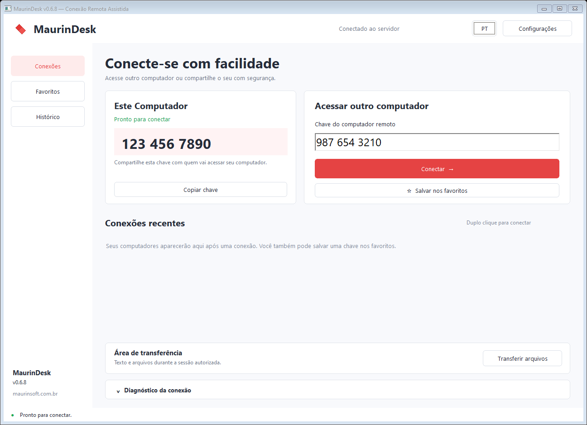
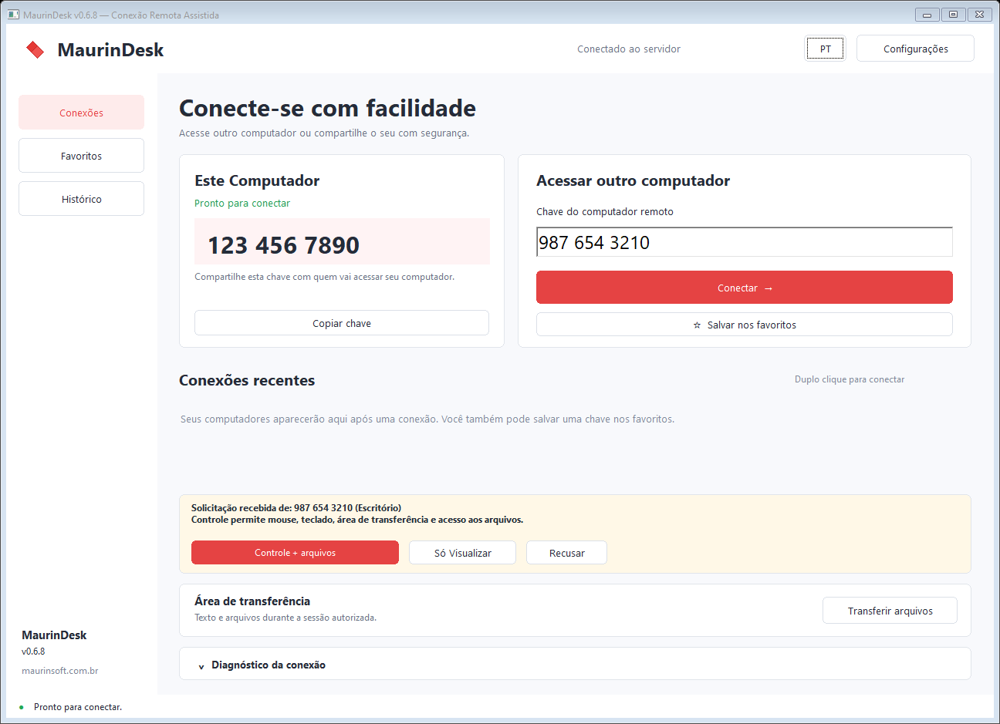
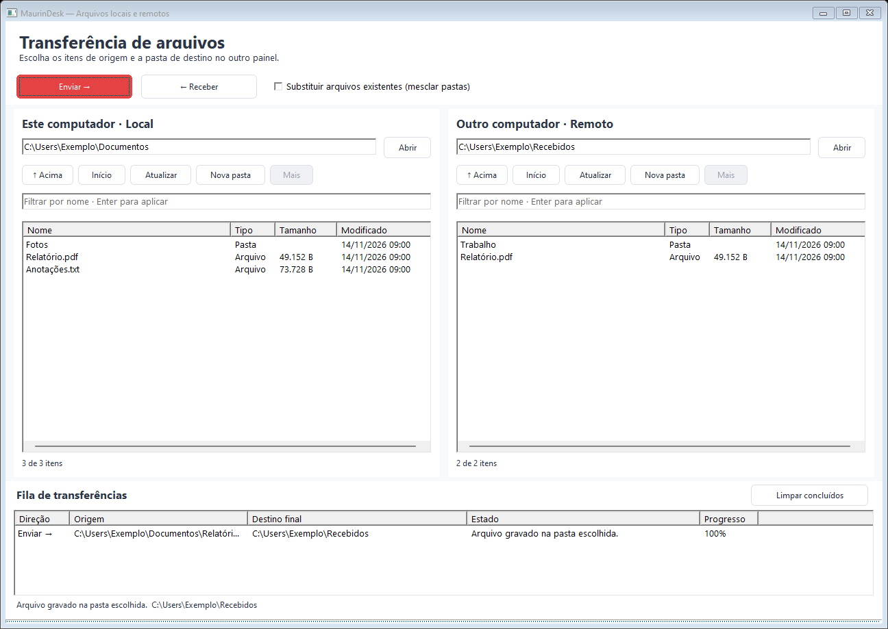

**Português** · [English](README.en.md) · [Español](README.es.md)

# MaurinDesk

### Atendimento remoto simples, com a pessoa atendida sempre no controle.

O **MaurinDesk** leva você até o computador de quem precisa de ajuda, em qualquer lugar com internet. Veja a tela, assuma o mouse e o teclado quando for autorizado e troque arquivos e pastas, tudo em um único programa para Windows.

[**Baixar o MaurinDesk**](bin/MaurinDesk.exe) · [Guia do usuário](docs/14-recursos-desktop.md) · [Fale com a MaurinSoft](https://maurinsoft.com.br)

*As imagens mostram a interface com chaves, nomes e arquivos de exemplo.*

## Por que escolher o MaurinDesk

| | |
|---|---|
| **Pronto em minutos** | Abra o programa e ele já mostra a chave do computador. Não é preciso cadastro nem mexer no roteador. |
| **Uma chave de 10 números** | Para conectar, basta digitar a chave que a outra pessoa informa por telefone ou mensagem. |
| **Quem recebe decide** | Cada conexão precisa ser aceita na hora, e a pessoa escolhe entre liberar o controle ou apenas mostrar a tela. |
| **Arquivos no lugar certo** | Envie e receba arquivos e pastas inteiras escolhendo a pasta de destino, com acompanhamento até a gravação. |
| **No seu idioma** | Interface em português, inglês e espanhol. |
| **Sempre atualizado** | O programa busca novas versões e confere a integridade do arquivo antes de instalar. |

## Para quem é

- **Suporte técnico e assistências:** atenda clientes sem deslocamento e resolva na primeira ligação.
- **Escritórios e equipes:** ajude um colega, acompanhe uma tarefa ou busque um documento em outro computador da empresa.
- **Aulas e treinamentos:** mostre sua tela para explicar um procedimento, sem entregar o controle.
- **Família e amigos:** ajude quem está longe a instalar, configurar ou encontrar o que precisa.

## Como funciona

1. **Abra o MaurinDesk nos dois computadores.** Cada um recebe sua chave de 10 números.
2. **Digite a chave do outro computador** e clique em **Conectar**.
3. **A outra pessoa aceita o pedido** e o atendimento começa. Qualquer um dos dois encerra quando quiser.

## O que você faz com ele

| Recurso | O que entrega |
|---|---|
| **Tela remota** | Veja o outro computador em uma janela ajustável ou em tela cheia, com troca de monitor quando houver múltiplas telas. |
| **Mouse e teclado** | Trabalhe no computador remoto como se estivesse diante dele, quando autorizado. |
| **Só visualizar** | Compartilhe a tela para demonstrações, sem permitir controle nem arquivos. |
| **Transferência de arquivos** | Dois painéis, um para cada computador, com fila e confirmação de gravação. |
| **Copiar e colar** | Use Ctrl+C e Ctrl+V entre os dois computadores durante a conexão. |
| **Favoritos e histórico** | Guarde os computadores atendidos com um nome fácil de lembrar. |
| **Sempre à mão** | Fica perto do relógio do Windows e pode iniciar junto com o computador. |

## Confiança em cada conexão

- **Nada acontece sem autorização.** Conhecer a chave não dá acesso; cada conexão precisa ser aceita por quem está no computador.
- **Permissões claras.** A pessoa atendida escolhe entre **Controle + arquivos**, **Só visualizar** ou **Recusar**.
- **Arquivos sob regra.** Somente quem iniciou a conexão navega nos arquivos do outro computador, e apenas quando isso foi autorizado.
- **Tudo às claras.** O programa fica visível durante o atendimento e qualquer participante pode desconectar.
- **Arquivos preservados.** Por padrão, nada é substituído no destino sem que você peça.
- **Comunicação protegida.** A conversa entre os computadores e o serviço usa conexão segura (HTTPS).

## O que é preciso

- Windows de 64 bits nos dois computadores.
- Acesso à internet.
- O MaurinDesk aberto dos dois lados, de preferência na mesma versão.

## Comece agora

[**Baixar o instalador para Windows (`MaurinDesk-Setup.exe`)**](bin/MaurinDesk-Setup.exe) ou [**baixar apenas o executável (`MaurinDesk.exe`)**](bin/MaurinDesk.exe) já é suficiente para o primeiro atendimento. O instalador já inclui as bibliotecas OpenSSL necessárias e configura a inicialização automática com o Windows (também ajustável em **Configurações**).

Quer usar o MaurinDesk na sua empresa ou tem uma necessidade específica? [Fale com a MaurinSoft](https://maurinsoft.com.br).

## Documentação

- [Guia do usuário](docs/14-recursos-desktop.md): passo a passo de cada recurso e respostas às dúvidas mais comuns.
- [Documentação técnica](docs/README.md): arquitetura, compilação, servidor e manutenção.
- [Histórico de versões](CHANGELOG.md)
