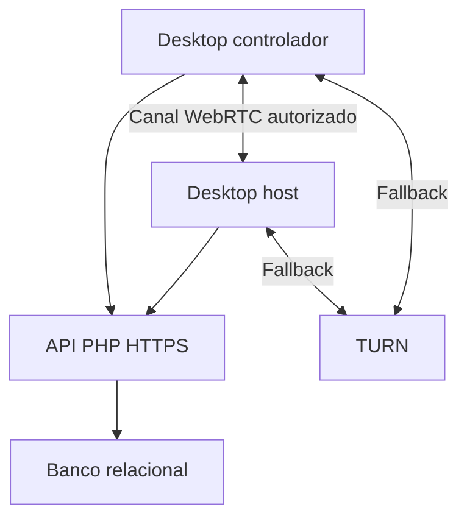

# Arquitetura proposta

> Servidor atualizado: consulte [ajuste Hostinger e P2P](11-servidor-hostinger.md). Os detalhes abaixo registram a proposta ou entrega anterior.

## Divisão de responsabilidades
| Camada | Responsabilidade | Local |
|---|---|---|
| Produto desktop | Janelas, consentimento, favoritos e orquestração | MaurinDesk/desktop |
| Biblioteca | Captura de desktop, entrada, protocolo, cliente API e sessão | CHATGPT |
| Controle | Registro, presença, consentimento e troca de SDP/ICE | MaurinDesk/server/api |
| Transporte | DataChannels WebRTC entre pares | CHATGPT + libdatachannel |
| Retransmissão | Tráfego WebRTC quando não houver rota direta | TURN dedicado |
| Persistência | Dispositivos, tokens, sessões e auditoria | Banco relacional da API |

A API em PHP não transporta continuamente imagens ou eventos de mouse/teclado. Opera por requisições HTTPS curtas e polling, compatíveis em princípio com hospedagem PHP convencional. TURN é um serviço de rede separado e depende de infraestrutura própria; não pode ser considerado disponível só porque o PHP está hospedado.

## Topologia

## Estados
| Estado | Transição permitida | Condição |
|---|---|---|
| pending | accepted, rejected, cancelled, expired | Só host aceita/recusa; controlador cancela; servidor expira |
| accepted | connecting, closed, expired | Tokens e permissões emitidos após decisão |
| connecting | active, closed, expired | Ambos confirmam canal e identidade negociados |
| active | closed, expired | Encerrar, bloquear SO ou perder liveness |
| rejected/cancelled/expired/closed | Nenhuma | Novo acesso usa nova sessão |

Aceitação é atômica e falha se pedido expirou ou host já está ocupado. Tempo do servidor é autoridade. Jobs de limpeza não são condição de segurança: cada consulta verifica expiração antes de retornar ou alterar estado. Endpoints de mídia e entrada locais também verificam estado, permissão e prazo.

## Protocolo entre desktops
MVP: quadros JPEG fragmentados e limitados sobre DataChannel, para reduzir escopo inicial de codecs; não confundir com trilhas de vídeo WebRTC já prontas. Negociar tamanho máximo de mensagem suportado pelo runtime antes do envio. Cabeçalho inclui protocol_version, session_id, stream_id, frame_id, fragment_index/count, geometry_version e dimensões. Limitar quadro comprimido a 4 MiB e remontagem a 2 quadros por sessão; expirar montagem incompleta em 1 s. Descartar quadros antigos em vez de acumular atraso.

Canal confiável de controle: eventos de botão, tecla, texto e término, com session_id, sequência monotônica e idade máxima. Movimento pode ser agregado, mantendo apenas posição mais recente. Fila de entrada limitada a 256 eventos; ao exceder, suspender controle e liberar botões/teclas. Cliente confirma capacidades: tamanho máximo, monitores, entrada e codec. Separar canal de quadros e de entrada para evitar bloqueio de controle por imagem grande. O componente atual exige extensão para múltiplos canais.

Coordenadas normalizadas no intervalo [0,1], monitor e versão de geometria; mapear para pixels físicos no host, incluindo DPI e origem negativa. Mudou resolução/monitor: anunciar geometria, limpar entrada antiga e exigir atualização do controlador. Unicode e códigos físicos devem ter tipos distintos; nunca converter entrada remota em comandos de shell.

Handshake vincula fingerprint DTLS ao SDP recebido pela sessão autenticada. Sem correspondência, fechar. O canal deve ser iniciado somente após autorização. A API é parte confiável da sinalização; um servidor comprometido pode alterar essa vinculação. Resistência a servidor malicioso exigiria verificação adicional entre usuários, fora do MVP.

## Modelo de dados proposto
| Tabela | Campos e restrições principais |
|---|---|
| devices | id UUID, public_key CHAR(10) UNIQUE, registration_id UNIQUE, display_name, platform, created_at, last_seen_at, disabled_at |
| device_tokens | id, device_id FK, token_hash UNIQUE, expires_at, revoked_at |
| sessions | id UUID, requester_id/host_id FK, state, permissions JSON, created_at, request_expires_at, accepted_at, ended_at, reason, version |
| host_locks | host_id PK/FK, session_id UNIQUE/FK; ocupado atomicamente na aceitação, liberado no término/expiração |
| session_tokens | hash, session_id FK, device_id FK, role, expires_at, revoked_at |
| signals | id incremental, session_id FK, sender_id FK, type, payload, created_at, expires_at |
| idempotency_keys | device_id, route, key, request_hash, response, expires_at; UNIQUE(device_id,route,key) |
| audit_events | id, request_id, session_id, actor_device_id, event_type, timestamp, reason |

Favoritos são locais e não requerem conta web. Campos secretos e payloads não entram na auditoria. Cadastro não coleta serial de disco, MAC nem impressão de hardware.

## Concorrência e falhas
Polling de pedidos e sinalização a cada 2 s, com jitter e backoff até 30 s em falhas. Heartbeat de sessão a cada 3 s; servidor e host encerram após 10 s sem confirmação válida. Peer heartbeat também a cada 3 s. Revogação remota pode levar até o próximo polling; revogação local não espera rede. Perda de canal termina a sessão no MVP: nada de retomar controle automaticamente.
