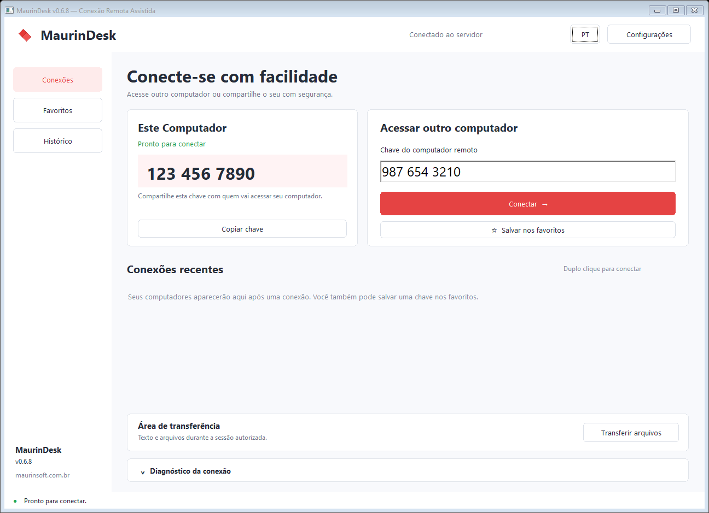
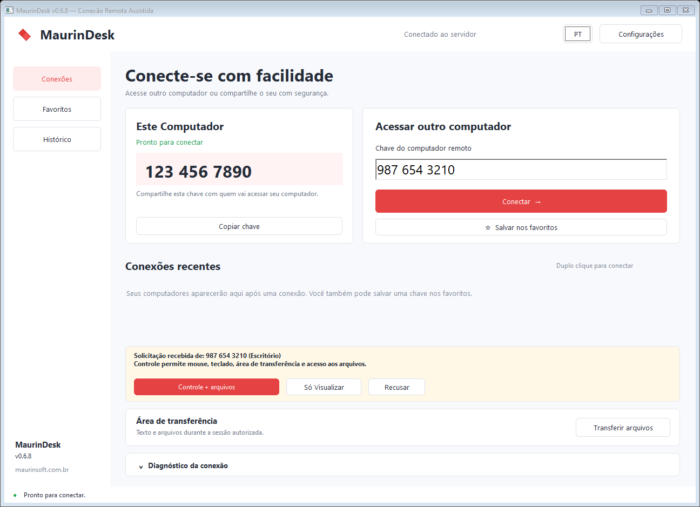
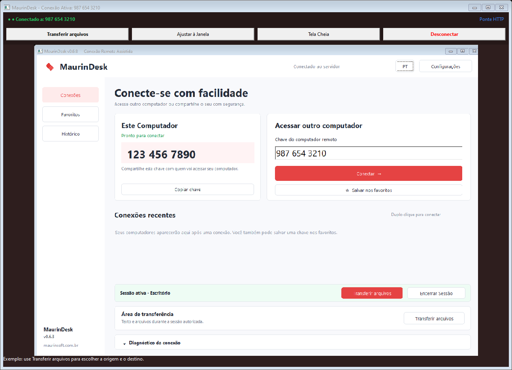
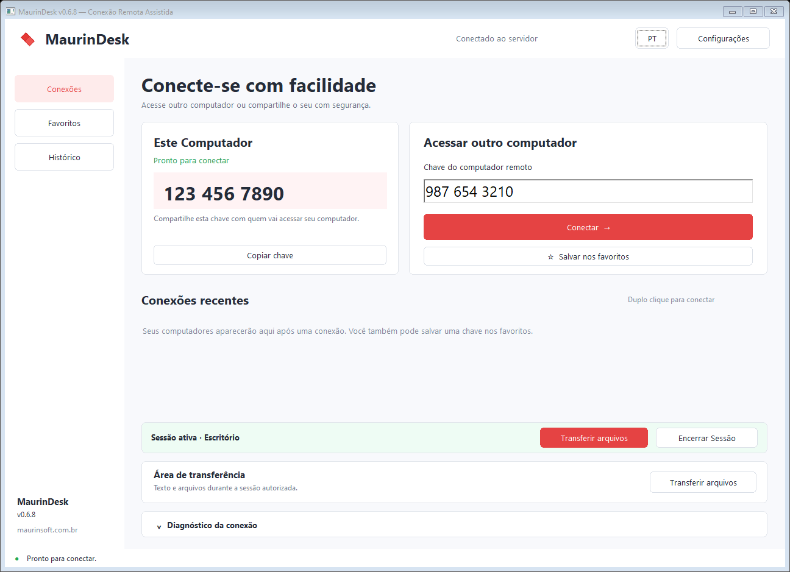
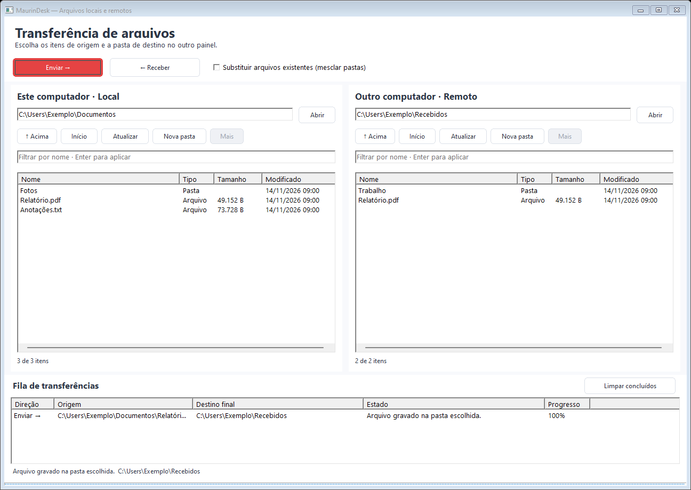
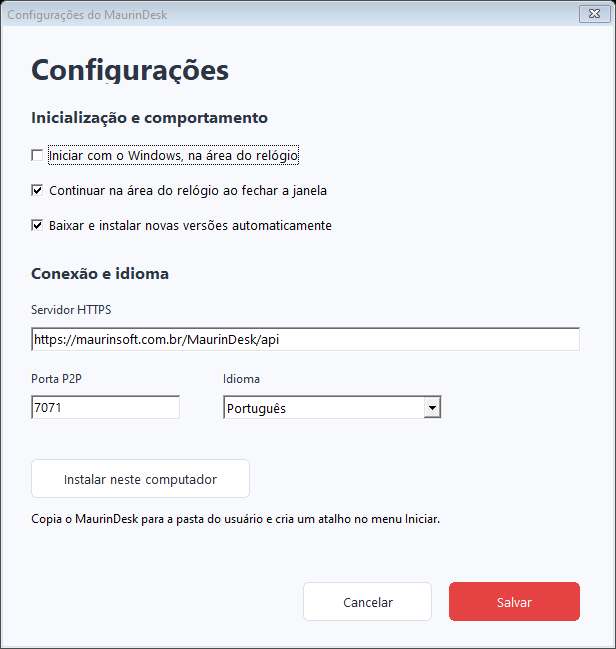

# Guia do usuário — MaurinDesk

**Versão 0.6.8 · Windows de 64 bits**

Este guia mostra como acessar outro computador, receber ajuda e trocar arquivos usando o MaurinDesk.

[Voltar à apresentação](../README.md) · [Conectar](#conectar-a-outro-computador) · [Transferir arquivos](#enviar-e-receber-arquivos) · [Configurar](#configurações-e-instalação) · [Resolver dificuldades](#quando-algo-não-funcionar)

*As imagens são capturas da interface do programa com dados e situações de exemplo. Chaves, nomes e arquivos mostrados não correspondem a um atendimento real.*

## Antes de começar

Abra o MaurinDesk nos dois computadores e confira se ambos têm acesso à internet. A pessoa que está no computador de destino precisa aceitar o pedido de conexão. Para usar todos os recursos deste guia, mantenha os dois programas atualizados.

O aplicativo se chama **MaurinDesk.exe**. Se estiver baixando pelo GitHub, abra o arquivo na pasta **bin** e use a opção de baixar o arquivo.

## Conheça a tela inicial

| Área | Como usar |
|---|---|
| **Este Computador** | Mostra sua chave de 10 números. Use **Copiar chave** para compartilhá-la. |
| **Acessar outro computador** | Recebe a chave do computador ao qual você quer se conectar. |
| **Conexões** | Volta à tela para iniciar um acesso. |
| **Favoritos** | Mostra as chaves que você guardou. |
| **Histórico** | Ajuda a encontrar computadores acessados antes. |
| **Configurações** | Reúne instalação, idioma, início com o Windows e outras preferências. |
| **Diagnóstico da conexão** | Mostra informações que ajudam o suporte a entender uma dificuldade. |

Espere sua chave aparecer antes de compartilhá-la. Os números das imagens servem apenas como exemplo.

## Conectar a outro computador

1. Peça à pessoa do outro lado a chave mostrada em **Este Computador**.
2. Digite os 10 números em **Chave do computador remoto**.
3. Clique em **Conectar**.
4. Aguarde a autorização no outro computador.
5. Quando o visualizador abrir, confira a imagem e comece o atendimento.

Se você estiver recebendo ajuda, compartilhe sua chave com a pessoa de confiança e aguarde a solicitação na sua tela.

### Aceitar ou recusar um pedido

Confira a identificação de quem solicita acesso. Escolha uma destas opções:

- **Controle + arquivos:** autoriza o uso do mouse e do teclado, a cópia e colagem entre os computadores e a transferência de arquivos e pastas.
- **Só visualizar:** permite acompanhar a tela; não autoriza controlar o computador nem transferir arquivos.
- **Recusar:** rejeita o pedido.

Uma chave salva nos favoritos não dispensa essa autorização em uma nova sessão. Se não reconhecer o solicitante, recuse o pedido.

## Usar a tela do outro computador

A imagem central mostra o computador acessado. Com autorização de controle, use o mouse e o teclado nessa área.

| Botão | Resultado |
|---|---|
| **Transferir arquivos** | Abre uma janela para escolher o que enviar ou receber e onde salvar. |
| **Ajustar à Janela** | Alterna o ajuste da imagem ao tamanho do visualizador. |
| **Tela Cheia** | Amplia a janela; o botão passa a permitir sair desse modo. |
| **Desconectar** | Encerra a sessão remota. |

Você também pode abrir os arquivos pela janela principal, sem procurar o botão dentro da imagem do outro computador:

O botão **Transferir arquivos** desse painel tem a mesma função do botão na barra do visualizador.

## Enviar e receber arquivos

Abra **Transferir arquivos** durante uma sessão autorizada em **Controle + arquivos**.

### Entenda os dois lados

- À **esquerda**, **Este computador · Local** mostra os arquivos da máquina que você está usando.
- À **direita**, **Outro computador · Remoto** mostra os arquivos da outra máquina.
- A **fila**, na parte inferior, mostra a origem, o destino final, o andamento e o resultado de cada transferência.

Para entrar em uma pasta, dê dois cliques. Você também pode escrever o caminho na barra acima da lista e clicar em **Abrir** ou pressionar **Enter**.

| Comando | Para que serve |
|---|---|
| **Acima** | Volta à pasta anterior no caminho. Ao chegar à raiz, permite escolher outra unidade. |
| **Início** | Abre a pasta inicial do usuário daquele computador. |
| **Atualizar** | Consulta novamente o conteúdo da pasta aberta. |
| **Nova pasta** | Cria uma pasta no painel escolhido. |
| **Mais** | Carrega mais itens quando a pasta contém uma lista longa. |
| **Filtrar por nome** | Ajuda a localizar um item. Digite parte do nome e pressione Enter. |

### Enviar do seu computador para o outro

Exemplo: levar **Relatório.pdf** de seus documentos para a pasta **Recebidos** do outro computador.

1. No painel **Local**, abra a pasta onde está o relatório.
2. Clique no arquivo para selecioná-lo.
3. No painel **Remoto**, abra a pasta **Recebidos**, ou outra pasta em que deseja salvar.
4. Confira os caminhos acima das duas listas.
5. Clique em **Enviar →**.
6. Aguarde a confirmação de gravação na fila e confira o arquivo no destino.

Para uma pasta inteira, selecione a pasta em vez de um arquivo. Para vários itens, mantenha **Ctrl** pressionado enquanto seleciona; **Shift** permite selecionar um intervalo.

### Receber do outro computador para o seu

1. No painel **Remoto**, abra a pasta de origem e selecione os arquivos ou pastas.
2. No painel **Local**, abra a pasta em que deseja guardar o conteúdo.
3. Clique em **← Receber**.
4. Aguarde a confirmação e confira os arquivos na pasta local escolhida.

O destino é a pasta aberta no painel que vai receber. O programa copia o conteúdo; o original permanece no computador de origem.

### Arquivos com o mesmo nome

Por padrão, arquivos e pastas de mesmo nome no destino impedem a cópia correspondente. O programa informa o conflito para você escolher outra pasta ou decidir pela substituição.

A opção **Substituir arquivos existentes (mesclar pastas)** permite substituir arquivos de mesmo nome. Ao mesclar pastas, os outros arquivos que já estavam nelas permanecem.

**Antes de marcar essa opção, confirme se deseja trocar o conteúdo que já existe.** Se precisar manter as duas versões, escolha outra pasta ou renomeie o arquivo pelo Explorador do Windows antes de enviar.

### Acompanhar a fila

A preparação, o envio e o recebimento podem levar algum tempo. Aguarde o aviso de que o conteúdo foi gravado na pasta escolhida. Se aparecer um erro, leia a mensagem antes de tentar novamente.

Fechar a janela de arquivos mantém a fila em andamento. Encerrar a sessão interrompe as transferências. Se houver uma interrupção ao copiar uma pasta grande, parte do conteúdo pode já ter chegado; confira o destino antes de repetir a cópia.

Use **Limpar concluídos** para retirar da lista os itens finalizados ou que terminaram com erro. Esse botão não apaga os arquivos que foram copiados.

### Tamanho e tipos de conteúdo

Você pode transferir documentos, fotos e outros arquivos, além de pastas completas, incluindo pastas vazias. Nomes com acentos são preservados.

Cada envio aceita até **128 itens selecionados** e cerca de **255 MB de conteúdo**, com até **10 mil arquivos e pastas** no conjunto. Para quantidades maiores, divida o conteúdo em vários envios. Pastas de rede e atalhos especiais do Windows para outras pastas não são atendidos pelo gerenciador.

## Copiar e colar com Ctrl+C e Ctrl+V

Durante uma conexão com autorização de controle e arquivos, você pode copiar um texto em um computador e colá-lo no outro.

1. Selecione o texto e pressione **Ctrl+C**.
2. Vá ao local em que deseja colocá-lo no outro computador.
3. Pressione **Ctrl+V**.

Arquivos e pastas também podem ser copiados dessa forma. Aguarde o recebimento antes de colar. Para escolher o destino final e acompanhar a cópia, prefira **Transferir arquivos**.

O compartilhamento começa após a autorização. Se você copiou algo antes de conectar, copie novamente. Textos são enviados sem preservar formatação como cores e estilos. Para uma imagem, copie o arquivo da imagem pelo Explorador; copiar uma imagem diretamente de outro programa pode não ser atendido.

## Favoritos, histórico e nomes

Para guardar uma chave, digite-a e clique em **Salvar nos favoritos**. Depois, use **Favoritos** para encontrá-la novamente.

Após encerrar uma conexão aceita, o programa pode pedir um nome para o computador acessado. Exemplos: **Escritório**, **Recepção** ou **Computador da família**. Esse nome ajuda a reconhecer a chave no histórico e nos favoritos. Se deixar em branco, permanece o número do computador.

Dê dois cliques no cartão do computador para iniciar outro pedido de acesso. A pessoa do outro lado ainda precisa aceitar a nova conexão.

## Configurações e instalação

Abra **Configurações** no canto superior da janela principal.

### Instalar neste computador

Clique em **Instalar neste computador**. O MaurinDesk será copiado para uma pasta própria e ganhará um atalho no menu Iniciar. Use esse atalho para abrir o programa nos próximos acessos.

### Abrir junto com o Windows

Marque **Iniciar com o Windows, na área do relógio** e clique em **Salvar**. O programa será iniciado quando você entrar no Windows.

### Continuar perto do relógio

Marque **Continuar na área do relógio ao fechar a janela** para manter o programa disponível depois de fechar a janela principal.

Para encontrá-lo, procure o ícone do MaurinDesk ao lado do relógio. Se não estiver visível, abra a seta de ícones ocultos do Windows. Clique no ícone ou escolha **Abrir MaurinDesk** no menu dele.

Para encerrar o programa completamente, escolha **Sair do MaurinDesk**. Isso também encerra a conexão ativa.

### Atualizar e escolher o idioma

Mantenha **Baixar e instalar novas versões automaticamente** marcada se quiser receber as novas versões disponíveis. A atualização pode aguardar o término de uma conexão para ser aplicada. Use versões atualizadas nos dois computadores.

Em **Idioma**, escolha português, inglês ou espanhol. Clique em **Salvar** para guardar as mudanças. Algumas preferências só podem ser alteradas depois de encerrar a sessão ativa.

Os campos de conexão podem permanecer com os valores fornecidos. Se precisar alterá-los, peça orientação a quem presta o suporte.

## Encerrar uma conexão

No visualizador, clique em **Desconectar**. Na janela principal, use **Encerrar sessão**. Qualquer participante pode finalizar o atendimento.

Fechar a janela principal pode apenas recolher o programa para perto do relógio, conforme sua configuração. Para garantir que saiu completamente, use **Sair do MaurinDesk** no menu do ícone.

## Quando algo não funcionar

| O que aconteceu | O que fazer |
|---|---|
| A chave não apareceu | Aguarde a conexão, confira a internet e tente abrir o programa novamente. |
| O pedido ainda não abriu a tela remota | Confira se a outra pessoa recebeu e aceitou a solicitação. |
| A conexão abriu, mas a imagem não aparece | Aguarde alguns instantes. Se continuar, encerre e tente novamente; informe o suporte se persistir. |
| O mouse e o teclado não controlam a tela | Confira se o pedido foi aceito com **Controle + arquivos**. **Só visualizar** não permite controlar. |
| A transferência informa falta de autorização | Faça uma nova conexão e peça o aceite em **Controle + arquivos**. |
| O botão de arquivos não aparece | Confira a versão nos dois computadores. Na versão 0.6.8 ele aparece na barra do visualizador e no painel da sessão ativa. |
| Um arquivo não foi copiado | Leia o resultado na fila, confira a pasta de destino e verifique se já há um item de mesmo nome. |
| Um envio é muito grande | Divida o conteúdo em envios menores, de até cerca de 255 MB cada. |
| Uma pasta não pode ser aberta | Escolha uma pasta à qual seu usuário do Windows tenha acesso. |
| Fechei a janela, mas o programa continua aberto | Procure o ícone perto do relógio e use **Sair do MaurinDesk**. |
| O ícone não está perto do relógio | Confira a seta de ícones ocultos. Se continuar ausente, mantenha a janela acessível e informe o suporte. |

Se precisar de ajuda, abra **Diagnóstico da conexão** na janela principal. Informe o que estava fazendo, o horário aproximado e a versão usada nos dois computadores. Confira o conteúdo antes de compartilhar imagens ou registros que possam mostrar informações pessoais.

[Voltar ao README](../README.md)
